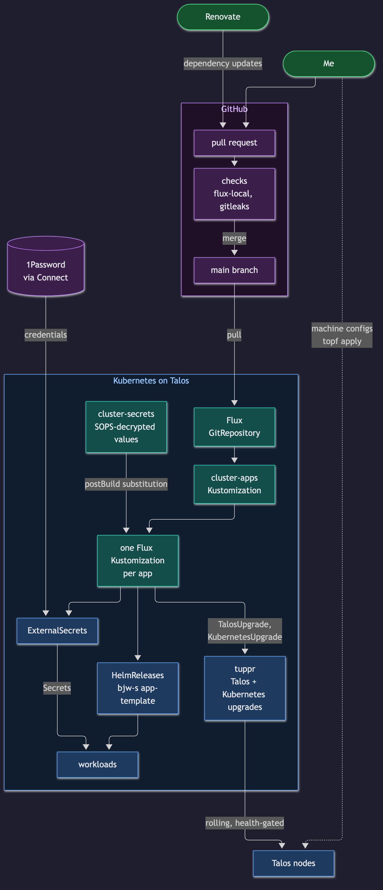
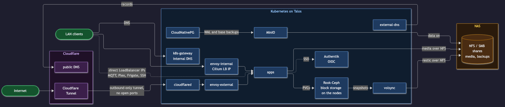

<div align="center">


### My Homelab Repository :snowflake:

_... automated via [Flux](https://fluxcd.io), [Renovate](https://github.com/renovatebot/renovate) and [GitHub Actions](https://github.com/features/actions)_ 🤖

</div>

<div align="center">

[](https://discord.gg/home-operations)&nbsp;&nbsp;

</div>

<div align="center">

[](https://www.talos.dev)&nbsp;&nbsp;
[](https://kubernetes.io)&nbsp;&nbsp;
[](https://fluxcd.io)&nbsp;&nbsp;
[](https://fluxcd.io)

</div>

<div align="center">

[](https://healthchecks.io)&nbsp;&nbsp;
[](https://github.com/home-operations/gatus-sidecar)&nbsp;&nbsp;
[](https://github.com/TwiN/gatus)&nbsp;&nbsp;
[](https://github.com/prometheus/alertmanager)&nbsp;&nbsp;
[](https://rook.io)&nbsp;&nbsp;
[](https://github.com/backube/volsync)

</div>

<div align="center">

[](https://github.com/kashalls/kromgo)&nbsp;&nbsp;
[](https://github.com/kashalls/kromgo/)&nbsp;&nbsp;
[](https://github.com/kashalls/kromgo/)&nbsp;&nbsp;
[](https://github.com/kashalls/kromgo/)&nbsp;&nbsp;
[](https://github.com/kashalls/kromgo/)&nbsp;&nbsp;
[](https://github.com/kashalls/kromgo/)&nbsp;&nbsp;
[](https://rook.io)&nbsp;&nbsp;
[](https://github.com/prometheus/node_exporter)&nbsp;&nbsp;
[](https://rook.io)&nbsp;&nbsp;
[](https://rook.io)&nbsp;&nbsp;
[](https://gateway.envoyproxy.io)&nbsp;&nbsp;


</div>

---

## 🤝 Thanks
- My amazing wife for putting up with... ME without her I would not be where I am today.
- [onedr0p](https://github.com/onedr0p) for [cluster-template](https://github.com/onedr0p/cluster-template), the starting point for all of this, and [home-ops](https://github.com/onedr0p/home-ops).
- The [Home Operations](https://discord.gg/home-operations) Discord community and the [home-operations](https://github.com/home-operations) projects.
- [joryirving/home-ops](https://github.com/joryirving/home-ops) - referenced a lot early on. 
- [bjw-s](https://github.com/bjw-s-labs/helm-charts) for app-template, which most of the apps here are built on.

Check out [kubesearch.dev](https://kubesearch.dev/) for examples of how other people deploy just about anything.

---

## Overview

This is the monorepo for my home Kubernetes cluster. Everything in it runs through Git: [Flux](https://github.com/fluxcd/flux2) applies it, [Renovate](https://github.com/renovatebot/renovate) keeps it current, and [GitHub Actions](https://github.com/features/actions) checks it before anything merges.

I started it to stay current with Kubernetes and GitOps. It has since turned into the thing that runs most of the services I use day to day, so it gets treated a little more seriously than a lab.

---

## 🌱 Where this started

I started this in July 2024 in a repo that's now archived, and moved to this one in February 2025 with a fresh render of [onedr0p/cluster-template](https://github.com/onedr0p/cluster-template). Both times the template handed me a bootable Talos cluster with Flux, Cilium, cert-manager, cloudflared, external-dns, k8s-gateway, ingress-nginx, Spegel and Reloader already wired together from one config file. That is an enormous head start, and saved me tons of time out the gate. 

Most of the patterns I added after that came from the [Home Operations](https://discord.gg/home-operations) community and the [home-operations](https://github.com/home-operations) projects: tuppr, gatus-sidecar and a lot of the container images. If you want to build something like this, start with the template, not with this repo.

If the history here looks suspiciously short, that's on purpose. The repo ran private for its first couple thousand commits, and a private repo collects things you wouldn't publish: LAN addresses, internal hostnames, NAS paths, CI running on in-cluster runners. Before going public I moved CI to GitHub hosted runners, pulled every one of those values into SOPS encrypted variables that Flux fills in at deploy time, rotated the SOPS key, cleared out dead apps, and checked the tree for anything that still leaked. That checking took nine separate review passes over about two and a half weeks, including a line by line read of my own, with automated leak checks rerun on every candidate tree in between. Most of the later passes still turned up something the earlier ones missed, which is the real lesson: one sweep is not enough. Only after a pass came back clean did I import it here as a single commit. The old repo stays private and archived; everything from here on happens in the open.

## 🛠️ How it differs from the template

After the February 2025 render I stopped re-rendering and started maintaining the manifests by hand. These are the bigger changes since then. The template has picked up a couple of them on its own (topf and Envoy Gateway), so read this as "different from the template as of February 2025".

**Talos and upgrades**

- Machine configs are built by [topf](https://github.com/postfinance/topf) from `talos/topf.yaml` instead of talhelper.
- [tuppr](https://github.com/home-operations/tuppr) runs Talos and Kubernetes upgrades from Git, health gated and one node at a time, instead of `talosctl upgrade` by hand.

**Ingress, DNS and auth**

- [Envoy Gateway](https://gateway.envoyproxy.io/) and the Gateway API replace ingress-nginx. The internal and external split is the same, as two Gateways.
- [Authentik](https://goauthentik.io/) does SSO. Its providers, apps, groups and login hardening live in Git as blueprints. Apps that speak OIDC talk to it directly, and apps that don't sit behind an Envoy `SecurityPolicy`.
- A second external-dns instance writes internal records to the UniFi router, next to the Cloudflare one.

**Secrets in a public repo**

- [External Secrets](https://external-secrets.io/) pulls app credentials from 1Password. SOPS only holds what has to exist before External Secrets is running.
- Anything that describes my network (IPs, internal hostnames, the domain, NAS paths) is SOPS encrypted and filled in by Flux postBuild substitution, which is what lets this repo be public. gitleaks runs on every PR as a backstop.

**Storage and data**

- [Rook-Ceph](https://rook.io/) on each node's NVMe for block and shared filesystem storage, OpenEBS hostpath where local disk is the better fit, and NFS from the NAS for bulk media.
- [VolSync](https://github.com/backube/volsync) backs up app data with restic to the NAS. An offsite copy to Cloudflare R2 is wired up as a component but not switched on yet. The restore runbook is in [docs/runbooks](./docs/runbooks).
- [CloudNativePG](https://cloudnative-pg.io/) runs Postgres, including a pgvector cluster, with backups to MinIO through the Barman Cloud plugin. [Dragonfly](https://www.dragonflydb.io/) is the shared Redis compatible cache.

**Observability**

- kube-prometheus-stack, Grafana, Loki and Tempo, fed by OpenTelemetry collectors (Talos's own logs included) and unpoller for the UniFi gear.
- Gatus checks every `HTTPRoute`, and Alertmanager sends alerts to Pushover.
- The badges at the top are live: kromgo and a small publisher job push them to a gist every few minutes.

**Network policy**

- Hubble flow metrics record which workloads talk to which, and this data is used to create `CiliumNetworkPolicy` for each namespace.

**Everything else**

- [actions-runner-controller](https://github.com/actions/actions-runner-controller) runs self-hosted GitHub Actions runners in the cluster.
- The [Flux Operator](https://github.com/controlplaneio-fluxcd/flux-operator) web UI, read only, behind Authentik.
- An `agent-readonly` ServiceAccount lets AI agents get, list and watch cluster state, with no access to Secrets, ConfigMaps, logs or exec.
- Intel GPU device plugin and Node Feature Discovery, so Plex, Immich and Frigate can use the iGPU.

---

## 🧭 Where it's going

One cluster is about to become two. Three new Dell Micros become `enterprise`, the production cluster. Once everything has moved over, the current three nodes get wiped and rebuilt as `holodeck`, a nonprod cluster with the same shape. Most of what has broken here so far was a platform change, not hardware, so the point is to rehearse Talos, Ceph and Cilium upgrades, drains and failovers somewhere that doesn't run the stuff I rely on. The guiding rule is to copy how this is done in an enterprise environment, minus the parts that only exist for big teams.

Planned, not started:

- **Layout:** a Flux base plus one overlay per cluster, split into infrastructure and apps, after [fluxcd/flux2-kustomize-helm-example](https://github.com/fluxcd/flux2-kustomize-helm-example). Every manifest is written once, and a cluster opts in with one line.
- **Isolation:** holodeck gets its own domain, Cloudflare account, SOPS key and 1Password vault. Nonprod can never read prod secrets.
- **Promotion:** versions are pinned per cluster. Renovate opens separate PRs, holodeck merges after CI passes, and a CI gate blocks an enterprise PR until that version has run on holodeck for three days.
- **Cutover:** apps move to enterprise in waves, restored from the existing VolSync and Postgres backups.
- **Access:** later, kubectl logs in through each cluster's Authentik, read only by default on prod.

Also on the list: turning on the R2 offsite copy before the cutover, and finishing network policies for the rest of the namespaces.

The split happens in public, as a series of PRs in this repo, so the history will show how it went, good or bad.

---

## ⛵ Kubernetes

### Installation

The cluster runs [Talos Linux](https://www.talos.dev), an immutable Kubernetes OS. It's semi hyperconverged: workloads and Ceph share the same nodes, and a separate NAS running TrueNAS Scale holds NFS/SMB shares, bulk files and backups.

Talos machine configs are built by [topf](https://github.com/postfinance/topf) from [`talos/topf.yaml`](./talos/topf.yaml) plus the strategic merge patches next to it, and applied straight to the nodes (`task talos:diff`, `task talos:apply-node NODE=<node-name>`). See [talos/README.md](./talos/README.md).

### Upgrades

Talos and Kubernetes upgrades are driven by [tuppr](https://github.com/home-operations/tuppr) from the `TalosUpgrade` and `KubernetesUpgrade` resources in [`kubernetes/apps/system-upgrade/tuppr/upgrades`](./kubernetes/apps/system-upgrade/tuppr/upgrades). Bumping a version there starts a health-gated rolling upgrade (nodes Ready, Ceph `HEALTH_OK`, the main Postgres cluster fully up), one node at a time, run from a node that isn't the one being upgraded. Go one minor version at a time and keep `talosVersion`/`kubernetesVersion` in `talos/topf.yaml` in step.

### Core Components

- [cilium](https://github.com/cilium/cilium): internal Kubernetes networking plugin
- [cert-manager](https://cert-manager.io/docs/): creates SSL certificates for services in my cluster
- [cloudflared](https://github.com/cloudflare/cloudflared): Cloudflare Tunnel that carries all public traffic into the cluster, no open ports on my network
- [envoy-gateway](https://gateway.envoyproxy.io/): Gateway API implementation that routes all HTTP traffic in the cluster through two Gateways, `envoy-internal` for LAN only apps and `envoy-external` for public ones. Apps that need SSO get native OIDC against Authentik through a `SecurityPolicy`
- [external-dns](https://github.com/kubernetes-sigs/external-dns): automatically syncs DNS records from my cluster's `HTTPRoute`s and `Service`s to a DNS provider
- [external-secrets](https://github.com/external-secrets/external-secrets/): managed Kubernetes secrets using [1Password](https://1password.com/) via 1Password Connect.
- [gatus](https://github.com/TwiN/gatus) + [gatus-sidecar](https://github.com/home-operations/gatus-sidecar): status page that automatically gets a health check for every `HTTPRoute` in the cluster, grouped by internal or external, behind Authentik
- [k8s-gateway](https://github.com/k8s-gateway/k8s_gateway): internal DNS server that answers for every hostname on an `HTTPRoute` or `Service` in the cluster
- [rook-ceph](https://rook.io/): Cloud native distributed block storage for Kubernetes
- [sops](https://github.com/getsops/sops): encrypted secrets and network values committed to Git
- [spegel](https://github.com/spegel-org/spegel): stateless cluster local OCI registry mirror
- [tuppr](https://github.com/home-operations/tuppr): health-gated, rolling Talos and Kubernetes upgrades driven from Git
- [volsync](https://github.com/backube/volsync): backup and recovery of persistent volume claims

### GitOps

[Flux](https://github.com/fluxcd/flux2) watches the clusters in my [kubernetes](./kubernetes/) folder (see Directories below) and makes the changes to my clusters based on the state of my Git repository.

The way Flux works for me here is it will recursively search the `kubernetes/apps` folder until it finds the most top level `kustomization.yaml` per directory and then apply all the resources listed in it. That aforementioned `kustomization.yaml` will generally only have a namespace resource and one or many Flux kustomizations. Those Flux kustomizations will generally have a `HelmRelease` or other resources related to the application underneath it which will be applied.

[Renovate](https://github.com/renovatebot/renovate) watches my **entire** repository looking for dependency updates, when they are found a PR is automatically created. When some PRs are merged Flux applies the changes to my cluster. Talos and Kubernetes version bumps are never automerged, since merging one starts a cluster upgrade, and Kubernetes is held at 1.36 until Cilium supports 1.37.

How a change gets from a PR to the cluster:



### Directories

This Git repository contains the following directories.

```sh
📁 kubernetes
├── 📁 apps           # applications
├── 📁 flux           # core flux configuration
└── 📁 components      # re-useable components
📁 talos              # Talos machine configs (topf.yaml + patches)
📁 docs
├── 📁 diagrams       # Mermaid sources (.mmd), rendered PNGs, render.sh
└── 📁 runbooks       # restore and recovery runbooks
```

### Networking

`LoadBalancer` Services get static IPs from Cilium's L2 announced LB-IPAM,
out of one shared pool on the node LAN
(`kubernetes/apps/kube-system/cilium/config/pool.yaml`). There's no
separate internal and external pool. Each IP is just an annotation on its
`Service`. Two annotation forms are in use, `lbipam.cilium.io/ips` and the
older `io.cilium/lb-ipam-ips`. Both work, so match whatever the app
already uses.

How traffic reaches the apps, and where their data and backups live:



Static addresses (nodes, the API VIP and every LoadBalancer IP) are kept
out of the repo: they're SOPS-encrypted `SECRET_*` values in
`kubernetes/components/common/cluster-secrets.sops.yaml`, filled in by Flux
postBuild substitution, and in `talos/topf.yaml` for the nodes.

---

## ☁️ Cloud Dependencies

While most of my infrastructure and workloads are self-hosted I do rely upon the cloud for certain key parts of my setup. This saves me from having to worry about two things. (1) Dealing with chicken/egg scenarios and (2) services I critically need whether my cluster is online or not.


| Service                                     | Use                                                               | Cost           |
|---------------------------------------------|-------------------------------------------------------------------|----------------|
| [1password](https://1password.com/)         | Secrets with [External Secrets](https://external-secrets.io/)     | $60/y        |
| [Cloudflare](https://www.cloudflare.com/)   | Domain, DNS and Tunnel (R2 for offsite backups planned)           | $12/y        |
| [GitHub](https://github.com/)               | Hosting this repository and continuous integration/deployments    | Free           |
| [Healthchecks.io](https://healthchecks.io/) | Monitoring internet connectivity and external facing applications | Free           |
|                                             |                                                                   | Total: All your sanity  |

---

## 🌐 DNS

### Home DNS

Inside the house, [k8s-gateway](https://github.com/k8s-gateway/k8s_gateway) answers for every hostname attached to an `HTTPRoute` or `Service`, pointing internal apps at `envoy-internal`. On top of that, an `external-dns` instance using the webhook provider syncs the same records to `unifi` via [external-dns-unifi-webhook](https://github.com/kashalls/external-dns-unifi-webhook).

### Public DNS

Outside the `external-dns` instance mentioned above another instance is deployed in my cluster and configured to sync DNS records to [Cloudflare](https://www.cloudflare.com/). It only publishes `HTTPRoute`s attached to the `envoy-external` Gateway (`--gateway-name=envoy-external`), plus a couple of `DNSEndpoint` records. Every public record is a proxied CNAME to my Cloudflare Tunnel, and `cloudflared` hands that traffic to `envoy-external`, so nothing internal can end up published by accident.

---

## 🔧 Hardware

### Main Kubernetes Cluster

| Purpose                  | Name       | Device       | CPU       | OS Disk   | Data Disk | RAM  | OS    |
|--------------------------|------------|--------------|-----------|-----------|-----------|------|-------|
| k8s control-plane/worker | *Redacted* | Dell 7080mff | i5-10600T | 256GB SSD | 1TB NVME  | 64GB | Talos |
| k8s control-plane/worker | *Redacted* | Dell 7080mff | i5-10600T | 256GB SSD | 1TB NVME  | 64GB | Talos |
| k8s control-plane/worker | *Redacted* | Dell 7080mff | i5-10600T | 256GB SSD | 1TB NVME  | 64GB | Talos |


- **Total CPU:** 18 cores / 36 threads
- **Total RAM:** 192 GB

### Supporting Hardware

| Purpose        | Name       | Device | CPU     | OS Disk  | Data Disk                 | RAM  | OS            |
|----------------|------------|--------|---------|----------|---------------------------|------|---------------|
| NAS/NFS/Backup | *Redacted* | Custom | i7-8700 | 1TB NVMe | 1 x RAIDZ2 6 wide(7.28TB) | 32GB | Truenas Scale |


### Networking/UPS Hardware

| Purpose          | Device          |
|------------------|-----------------|
| Network - Router | UniFi UDM-SE    |
| Network - Switch | USW-Lite-16-POE |
| Network - Switch | USW-Pro-Max-24  |
| WAP              | U7 Pro          |
| Power - PDU      | USP-PDU-Pro     |


---

## ⭐ Stargazers

<div align="center">

[](https://star-history.com/#heathbar2151/utopia-planitia&Date)

</div>

---

## 🔏 License

See [LICENSE](./LICENSE)
